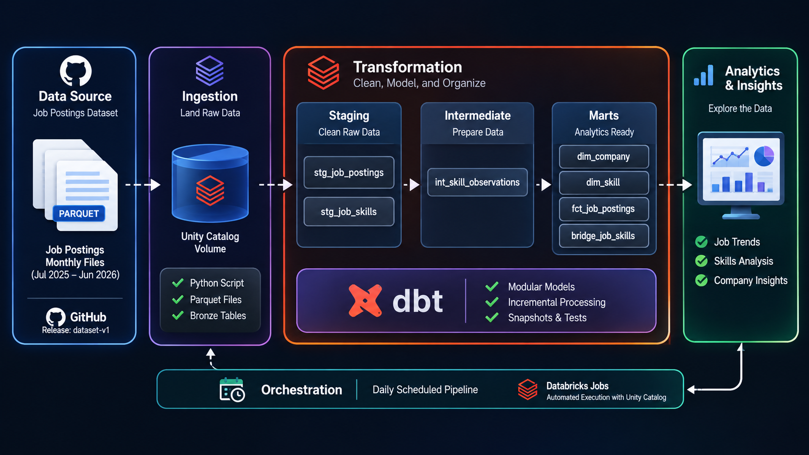
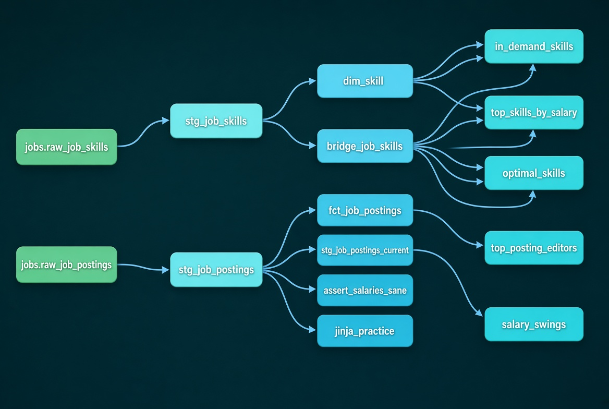

# Job Postings Analytics Pipeline | Databricks & dbt



## Overview

This project builds an analytics pipeline for job-posting data using
Databricks and dbt. Raw job-posting and skills data is landed in
Databricks, organized into analytics-friendly models, and transformed
into a dimensional structure that supports SQL analysis.

The goal is to create a repeatable workflow. Ingesting raw files
to transforming, testing, and maintaining models.

## Architecture

The pipeline follows a layered approach:

1.  **Raw (Bronze):** Download the course Parquet dataset into a Unity
    Catalog Volume and land it as raw tables.
2.  **Staging:** Clean and standardize source data, prepare fields for
    downstream transformations, and apply consistent naming and types.
3.  **Intermediate:** Combine and reshape data to support reusable
    downstream logic.
4.  **Marts:** Build analytics-ready fact, dimension, and bridge models
    for querying job postings and skills.

dbt manages dependencies between models, while Databricks provides the
storage and compute environment.

## DBT Pipeline

Raw -> Staging -> Intermediate -> Star-Scema Marts. Snapshots capture the history off staging. Every dbt model built is shown below.



## Data Ingestion

The raw-loading notebook/script retrieves the dataset from a pinned
GitHub release and writes the files directly into a Unity Catalog
Volume. It then creates raw tables from the landed Parquet files.

The ingestion step is designed to be rerunnable: existing files in the
Volume are skipped during download, while raw tables can be recreated
from the stored files.

## Data Modeling & Transformation

dbt organizes transformations into modular models and manages
dependencies.

-   **Staging models:** standardize source data and prepare it for
    analysis.
-   **Intermediate models:** perform reusable transformations and
    combine related data.
-   **Mart models:** create the final analytics-ready data structure,
    including job postings and skill relationships.

The mart layer uses a dimensional model, with fact, dimension, and
bridge tables representing job postings and associated skills.

## Data Quality & Testing

Data quality checks are incorporated into the dbt workflow. Tests help
validate assumptions and catch issues as models are developed and
executed. The dbt build workflow runs model transformations and tests
together, helping identify problems before downstream analysis.

## Incremental Processing & Historical Tracking

Incremental processing is used to avoid unnecessarily rebuilding the
full fact dataset when new job-posting data arrives. Snapshots preserve
changes to job-posting records over time, allowing historical versions
to be analyzed rather than only the latest state.

## Orchestration

The workflow is designed to run through a Databricks Job. The ingestion
task runs first, followed by dbt dependency installation, connection
validation, and model building. Scheduling the job makes the pipeline
repeatable without manually running every step.

## Technology Stack

-   **Python** - data ingestion, file handling, and pipeline orchestration logic.
-   **Apache Spark / PySpark** - Spark SQL and distributed data processing in Databricks.
-   **Databricks** - compute, storage, workspace, and job execution
-   **Unity Catalog** - catalog, schema, table, and Volume
    organization
-   **dbt** - transformations, model dependencies, tests, and
    snapshots
-   **SQL** - transformations and analysis
-   **GitHub** - source control and dataset hosting

## Repository Structure

```text
 dbt-databricks-pipeline/
 ├── analytics/
 │   ├── analyses/
 │   ├── dbt_packages/
 │   ├── logs/
 │   ├── macros/
 │   ├── models/
 │   │   ├── intermediate/
 │   │   │   ├── int_skill_observations.sql
 │   │   │   └── intermediate.yml
 │   │   ├── marts/
 │   │   │   ├── bridge_job_skills.sql
 │   │   │   ├── dim_company.sql
 │   │   │   ├── dim_skill.sql
 │   │   │   ├── fct_job_postings.sql
 │   │   │   └── marts.yml
 │   │   └── staging/
 │   │       ├── staging.yml
 │   │       ├── stg_job_postings_current.sql
 │   │       ├── stg_job_postings.sql
 │   │       ├── stg_job_skills.sql
 │   │       └── sources.yml
 │     ├── seeds/
 │     ├── snapshots/
 │     ├── target/
 │     ├── tests/
 │     ├── .gitignore
 │     ├── dbt_project.yml
 │     ├── package-lock.yml
 │     └── packages.yml
 ├── img/
 ├── logs/
 ├── scripts/
 │   ├── backfill_job_postings_snapshot.sql
 │     └── load_raw.py
 ├── src/
 ├── .gitignore
 ├── .python-version
 ├── pyproject.toml
 ├── README.md
 └── uv.lock
```


## Running the Project

Requirements include a Databricks workspace with access to the raw
dataset/catalog, Python, and dbt configured for the Databricks target.

From the dbt project directory:

``` bash
dbt deps
dbt debug
dbt build
```

Snapshots can be run separately when historical tracking needs to be
updated:

``` bash
dbt snapshot
```

The raw ingestion step must be completed before building models that
depend on the raw tables.

## What I Learned

-   Building a pipeline that moves source files into cloud storage and
    warehouse tables.
-   Structuring dbt models into staging, intermediate, and mart layers.
-   Using dimensional modeling concepts, including fact, dimension, and
    bridge tables.
-   Managing model dependencies with dbt.
-   Implementing incremental processing and historical snapshots.
-   Adding tests to validate data quality.
-   Organizing and running pipeline tasks through Databricks Jobs.

------------------------------------------------------------------------

This project demonstrates an end-to-end analytics engineering workflow,
from raw data ingestion to tested, analytics-ready models in Databricks.
